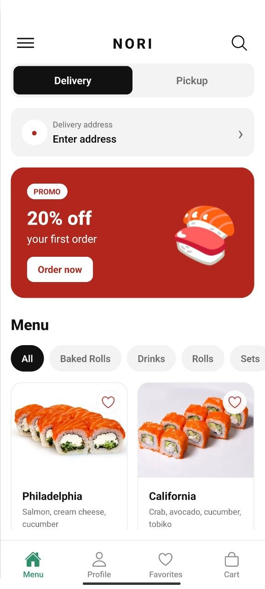
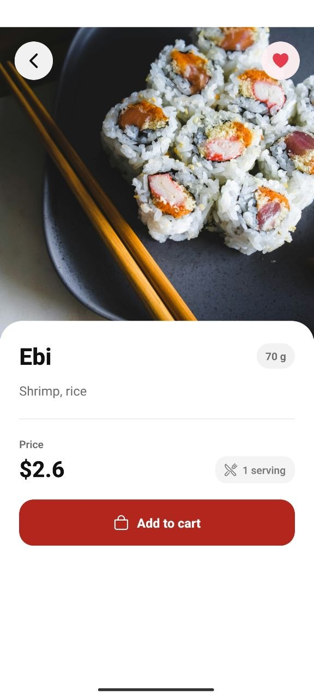
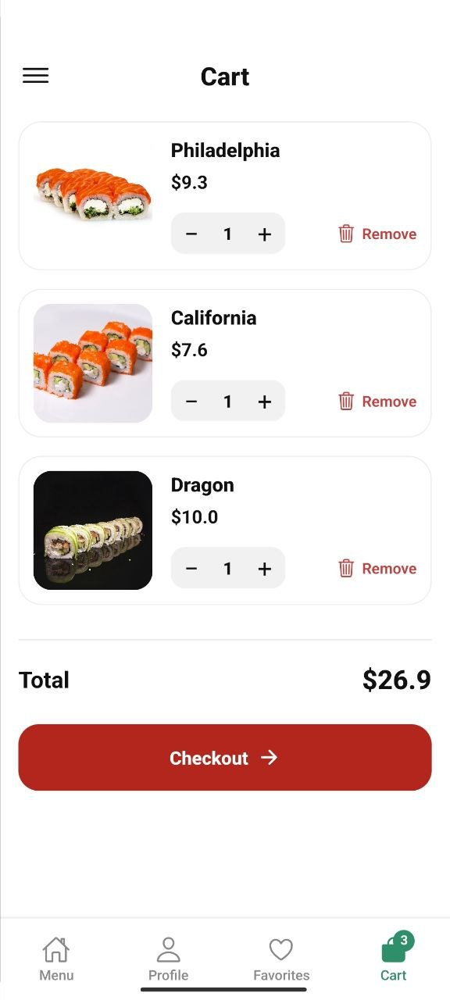
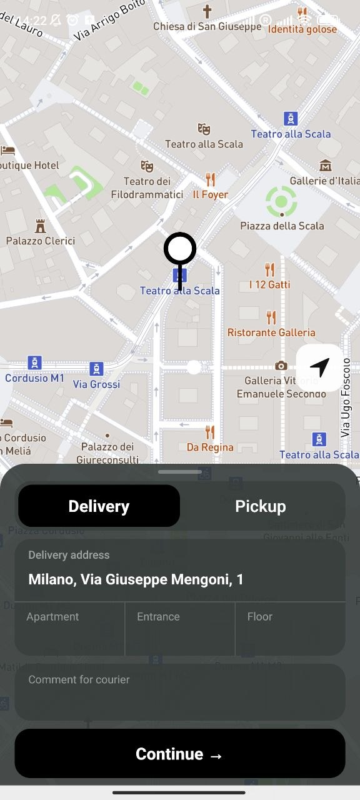
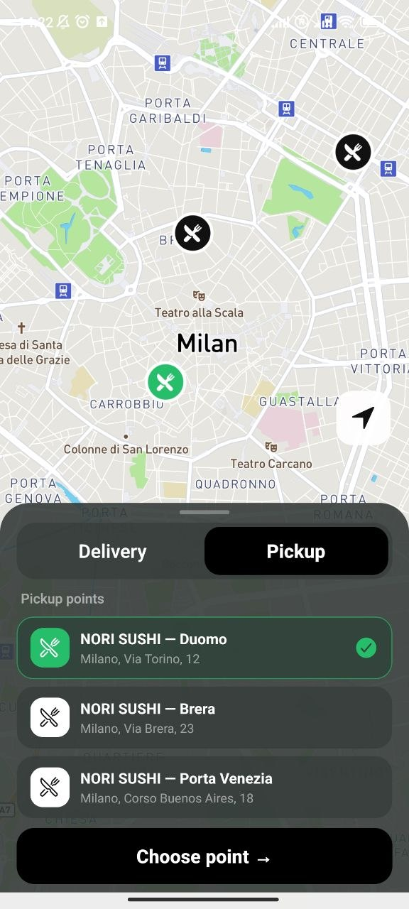
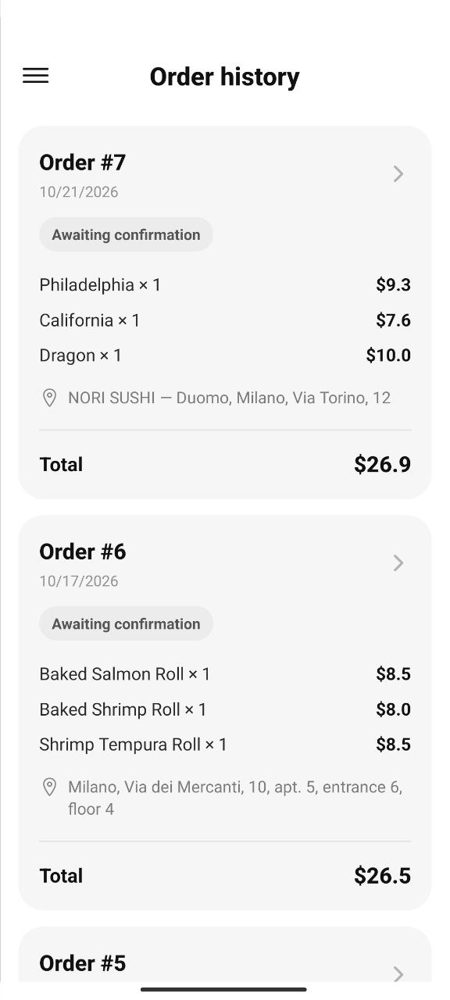
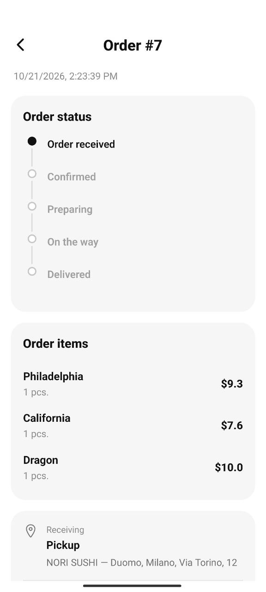

# NORI SUSHI

NORI SUSHI is a full-stack sushi delivery mobile application built with React Native, Expo, NestJS, Prisma, and PostgreSQL.

The project includes a mobile client, authentication, product catalog, favorites, delivery addresses, map integration, and order management.

## Demo

Android demo APKs are available in GitHub Releases.

- Universal APK — compatible with more Android devices
- ARM64 APK — smaller build for modern ARM64 Android devices

> This is a portfolio/demo project and is not published on Google Play.

## Features

- Product catalog with categories
- Russian and English localization
- Dynamic product names and descriptions
- Google authentication
- Telegram authentication
- User profile
- Favorites
- Cart
- Delivery and pickup
- Address management
- Mapbox map integration
- Order creation
- Order history
- Order details
- Order cancellation
- Repeat order
- Guest orders
- Persistent authentication
- Responsive Android UI

## Tech Stack

### Mobile

- React Native
- Expo
- TypeScript
- React Navigation
- Zustand
- i18next
- Mapbox
- Expo Location
- Google Sign-In
- Expo Secure Store

### Backend

- NestJS
- TypeScript
- Prisma ORM
- PostgreSQL
- Neon
- JWT authentication
- Google Auth Library
- Telegram Bot API

### Deployment

- Backend: Render
- Database: Neon PostgreSQL
- Android builds: Expo EAS Build

## Project Structure

```text
nori-sushi/
├── sushi-delivery/   # React Native / Expo mobile app
├── sushi-backend/    # NestJS backend
└── README.md
```

## Backend

The backend is deployed on Render:

https://nori-sushi.onrender.com

Example public endpoint:

https://nori-sushi.onrender.com/products

Because the backend uses a free Render instance, the first request after a period of inactivity may take longer while the service wakes up.

## Android Installation

Download the latest release from the Releases section.

Use:

- `NORI-SUSHI-arm64.apk` for most modern Android devices
- `NORI-SUSHI-universal.apk` if you are unsure about your device architecture

Android may ask you to allow installation from unknown sources because the demo is distributed outside Google Play.

## Local Development

### Backend

```bash
cd sushi-backend
npm install
npm run start:dev
```

### Mobile

```bash
cd sushi-delivery
npm install
npx expo start --dev-client
```

The mobile application requires environment variables for:

- backend API
- Mapbox
- Google authentication

## Architecture

```text
React Native / Expo
        |
        | HTTPS
        v
NestJS REST API
        |
        v
Prisma ORM
        |
        v
Neon PostgreSQL
```

External services include:

- Google Sign-In
- Telegram Bot API
- Mapbox

## Languages

The application supports:

- English
- Russian

The app automatically detects the device language and also allows manual language switching.

## Screenshots

## Screenshots

<p align="center">
  
  
  
</p>

<p align="center">
  
  
  
</p>

<p align="center">
  
  
</p>

## Status

Portfolio demo — Android version completed.

## Author

Arsen Esenbolatov
